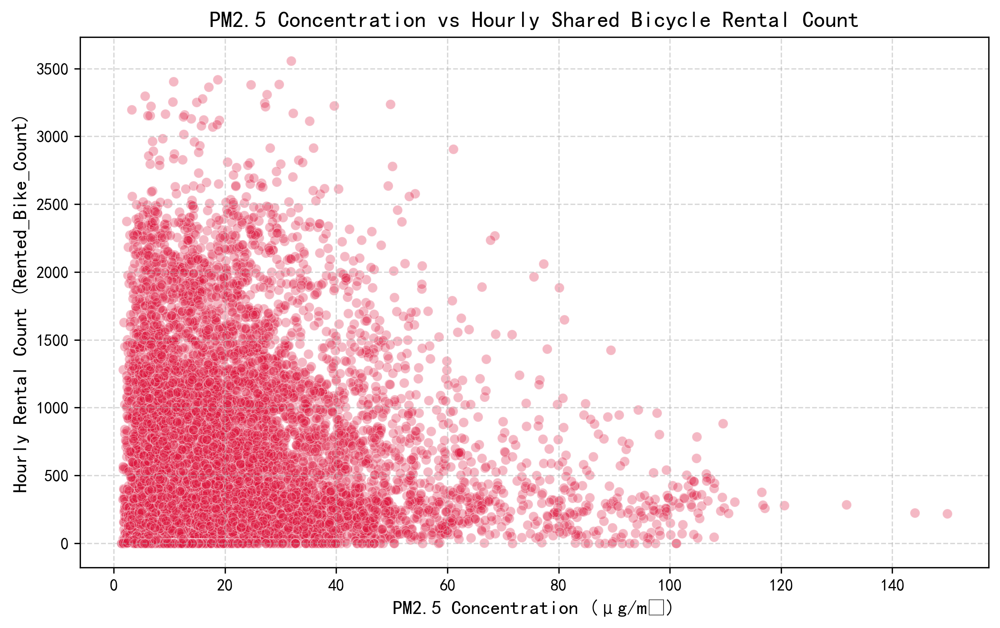
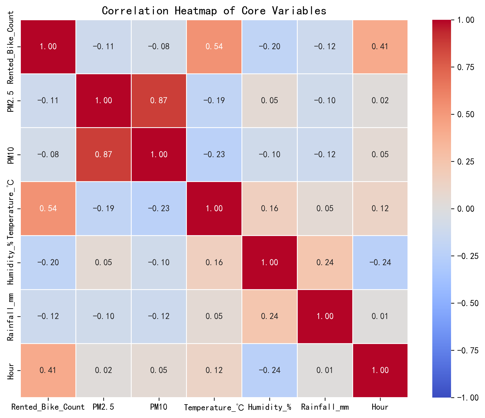

# My Data Science Portfolio

## About Me
I'm LI LUSHI. I am a Master student in Data Science. 
## Technical Skills
My technical skills include Python, Pandas, Scikit-learn, Data Visualization, and Statistical Modeling.

## Project Showcase

### Impacts of Meteorological Factors and Air Quality on Shared-Bicycle Usage in Seoul
- **Research Question**: How do meteorological variables and air quality (PM2.5/PM10) affect hourly shared-bicycle rental volume in Seoul?
- **Key Finding**: Air pollution (PM2.5) and rainfall negatively impact bicycle rentals, while temperature has a strong positive effect. The linear regression model achieved an R² of 0.4583.
- **Visualization**:
  
  This scatter plot shows the relationship between PM2.5 concentration and hourly shared-bicycle rental volume. Higher PM2.5 is associated with lower bicycle rental counts.

  
This heatmap visualises pairwise correlations between weather, air pollution and bicycle rental variables.
- **Project Repository**: [Link to Project Repo](https://github.com/LI-LUSHI/data-science-project)
- **Project Status**: In Progress
